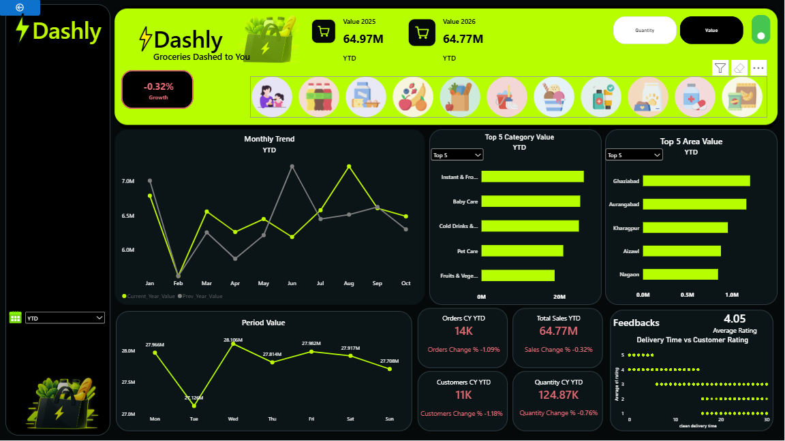
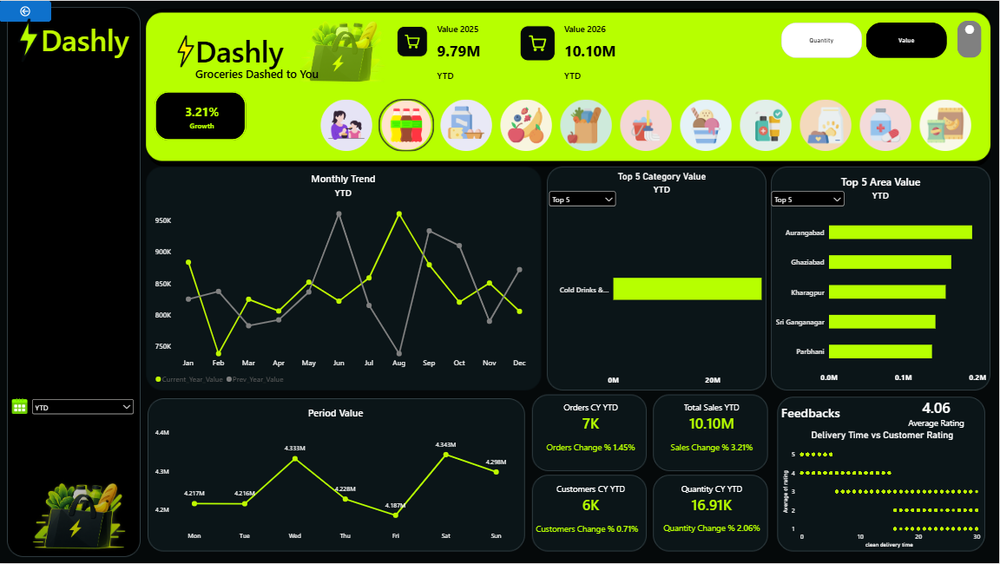
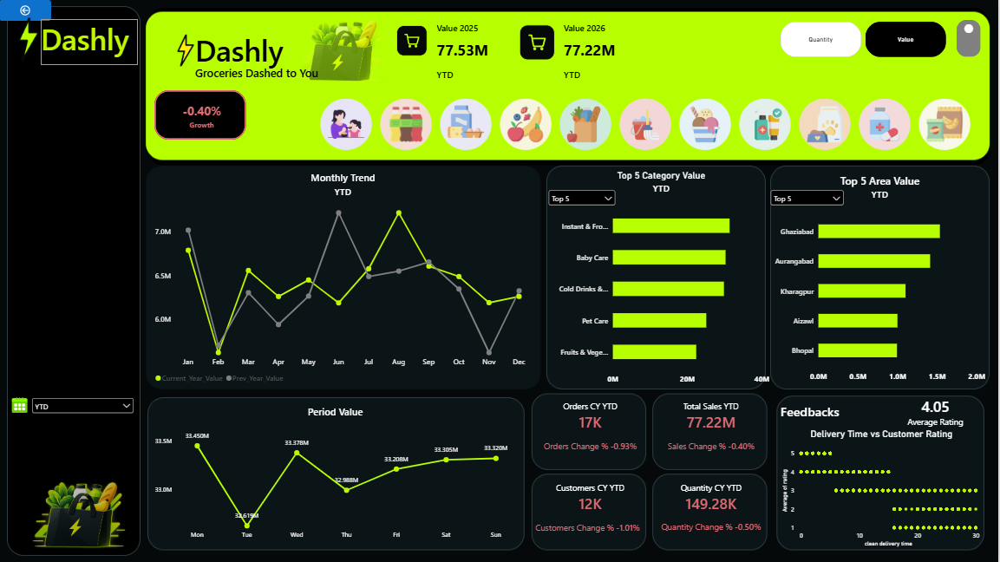

# Dashly — Grocery Sales & Delivery Analytics Dashboard

An interactive Power BI dashboard for analyzing grocery sales, category performance, geographic trends, and delivery experience using a synthetic dataset.

Dashly is a data analytics portfolio project demonstrating an end-to-end analytics workflow, from data exploration and SQL queries in MySQL to data transformation, DAX calculations, and interactive dashboard development in Power BI.
## Dashboard Preview

### Automatic Date Selection

### Category Growth Analysis

### Full-Year Sales Comparison

## Overview

Dashly transforms grocery sales and delivery data into an interactive reporting experience. It allows users to explore key performance indicators, compare sales across years and reporting periods, analyze category performance, rank geographic areas, and investigate the relationship between delivery time and customer satisfaction.

The project emphasizes data preparation, analytical problem-solving, dynamic reporting, and translating data into business-relevant insights.

**Project Type:** Data Analytics Portfolio Project  
**Dataset:** Synthetic grocery sales and delivery data  
**Model Size:** 450,476 rows  
**Tools:** MySQL, Power BI, Power Query (M), DAX, Figma

## Key Findings

*The findings below are based on the synthetic dataset and should not be interpreted as claims about the real grocery industry.*

### 1. Full-Year Sales Performance

Full-year sales were approximately ₹77.53M in 2025 and ₹77.22M in 2026, representing a decrease of approximately ₹0.31M, or 0.40%, compared with 2025.

Separate DAX measures were created to calculate sales for each calendar year. These measures remove filters from the Calendar table and apply the relevant year filter, allowing annual sales to be examined independently of the dashboard's selected reporting period.

Although the overall change in sales was relatively small, category-level and monthly analysis revealed differences in performance that aggregate figures alone would not capture.

The latest order date in the dataset is 30 December 2026. Therefore, the 2026 figure represents the available data for that calendar year and may not include the final calendar day.

### 2. Category Revenue and Growth

Instant & Frozen Food was the highest-revenue category, generating approximately ₹10.4M in reported year-to-date sales, with reported growth of −0.5%.

Cold Drinks & Juices recorded the strongest reported category growth at +3.21%, despite not being the highest-revenue category.

This demonstrates why revenue and growth should be evaluated separately when assessing category performance. A category generating the most revenue does not necessarily have the strongest growth.

### 3. Geographic Performance

Ghaziabad ranked first in the Top 5 Area Value comparison.

Geographic rankings provide a starting point for investigating regional differences in sales performance and identifying locations that may warrant further analysis.

### 4. Monthly Sales Trends

August recorded the highest monthly sales peak in the current-year view, while June was the strongest month in the previous-year view.

Comparing monthly performance across years helps reveal variations that may not be apparent from aggregate sales figures alone.

### 5. Delivery Time and Customer Satisfaction

The delivery-time versus customer-rating scatter chart showed that 4- and 5-star ratings were concentrated more heavily among faster deliveries, while 1-star ratings appeared more frequently among the slowest deliveries.

Three- and four-star ratings were the most common overall.

These observations describe a pattern in the synthetic dataset, not a proven causal relationship. Other factors may also influence customer satisfaction.

## Dashboard Features

### 1. KPI Cards

Displays four key performance indicators:

- Orders
- Sales
- Customers
- Quantity

Percentage-change indicators support comparisons between reporting periods defined by the dashboard's measures and filters.

### 2. Dynamic Time-Period Selection

The dashboard supports manual period selection and automatic current-date-based reporting.

**Manual Mode**

Users can select a reporting period from the available options:

- Last Month
- Last 2 Months
- Last 3 Months
- Last 6 Months
- Last 9 Months
- YTD (Year to Date)

The selected period is used by the relevant DAX measures to determine the reporting cutoff.

**Automatic Mode**

To switch to automatic mode, users simply click the **button in the top-right corner of the dashboard**.

In automatic mode, the dashboard uses the system date to determine the current year and month for its date-dependent calculations, including year-to-date reporting. This allows the reporting period to adapt as the calendar advances.

Users can switch between manual and automatic modes using the same top-right button, making it easy to explore selected reporting periods or view current-date-based results without navigating to another report page.

The functionality is implemented using DAX measures that respond to the active date-selection mode and determine the appropriate reporting year and month cutoff.

### 3. Full-Year Sales Comparison

Separate DAX measures calculate annual sales for 2025 and 2026.

These measures remove filters from the Calendar table and apply a fixed year filter, providing a way to inspect annual sales independently of the dashboard's selected time-period filters.

This approach also helps validate annual sales figures against the results of the dashboard's time-period-dependent measures.

### 4. Value / Quantity Toggle

Allows users to switch between monetary value and quantity sold, providing different perspectives on business performance without requiring separate visualizations.

### 5. Dynamic Top N Rankings

Supports Top 5 and Top 10 rankings for products and geographic areas, with ranking logic and titles responding to the selected option.

The synthetic dataset does not provide individual product names, which limits detailed product-level analysis.

### 6. Monthly Trend Comparison

Compares current-year and previous-year monthly sales to help identify changes in performance patterns and highlight stronger or weaker months.

### 7. Category Explorer

Allows users to select a category and explore its performance across relevant report visualizations.

### 8. Delivery Time vs. Customer Satisfaction

Uses a scatter chart to investigate the relationship between delivery duration and customer ratings.

A DAX measure excludes negative delivery durations and durations exceeding 180 minutes from this visualization. This is a project-specific filtering rule intended to reduce the influence of extreme or invalid values. It does not independently validate the underlying timestamps.

### 9. Dashboard Design

Features a dark visual theme, high-contrast accent colors, consistent KPI card styling, and a structured layout planned in Figma before implementation in Power BI.

## Technical Stack

| Tool | Application |
|---|---|
| MySQL | Data exploration, joins, aggregation queries, and data-quality investigation |
| Power Query (M) | Data transformation, date handling, and model preparation |
| DAX | Measures, time intelligence, period calculations, growth indicators, dynamic rankings, and titles |
| Power BI | Data modeling, interactive report development, KPI cards, slicers, and visualizations |
| Figma | Dashboard layout planning, visual design, and branding |

## Development Process

The project followed an end-to-end analytics workflow:

1. **Data Exploration:** Imported and explored the dataset in MySQL to understand its structure and identify potential data-quality issues.
2. **SQL Analysis:** Used joins and aggregation queries to investigate relationships between tables and examine sales figures.
3. **Data Transformation:** Cleaned and shaped data using Power Query, including date handling and model preparation.
4. **Data Modeling:** Built a Calendar table and configured date relationships to support time-based reporting.
5. **DAX Development:** Created measures for sales, year-to-date calculations, reporting-period selection, year filtering, growth indicators, and dynamic rankings.
6. **Visualization:** Developed KPI cards, charts, slicers, and interactive report elements in Power BI.
7. **Validation:** Investigated delivery-duration anomalies, timestamp inconsistencies, join mismatches, and differences between filtered and overall KPI values.
8. **Dashboard Design:** Planned the visual layout and branding in Figma before implementing the report in Power BI.

## Challenges and Solutions

### 1. Data-Type Mismatch in SQL Joins

A join using `product_id` returned no matches even though the identifiers appeared identical. One table stored IDs as integers, such as `665753`, while another stored them as text with a trailing decimal, such as `665753.0`.

The issue was resolved by converting the columns to consistent numeric types before joining.

### 2. Date and Period-Comparison Logic

Implementing year-to-date calculations and year-based comparisons required careful handling of Calendar relationships, selected month indexes, and filter context.

Separate DAX measures determine the reporting year and month cutoff based on whether automatic or manual date selection is active.

This highlighted the importance of validating date logic rather than relying solely on results that appear plausible.

### 3. Dynamic Top N Rankings

Supporting multiple ranking options without creating duplicate visuals required dynamic ranking logic and selection-dependent titles.

This approach made the report more flexible while maintaining a consistent layout.

### 4. Delivery Data Quality

The dataset contained negative delivery durations and timestamps that did not always align with calculated durations.

A DAX measure was implemented to exclude durations below zero and above 180 minutes from the scatter chart. This improves the visualization but does not establish that all remaining delivery records are accurate.

### 5. Filter Context and KPI Validation

KPI values changed when category selections and other filters were applied. This made it important to distinguish filtered values from overall results.

Separate annual sales measures were used to remove filters from the Calendar table and calculate sales for specific years. This provided a more direct way to validate annual sales independently of the selected reporting period.

## Business Questions

This dashboard was designed to answer the following business questions:

- **Sales Performance:** How does total sales revenue compare between the current and previous years?
- **Category Analysis:** Which product categories generate the highest revenue, and which show the strongest growth?
- **Geographic Performance:** Which areas contribute the most to total sales?
- **Monthly Trends:** Which months record the highest sales, and how do monthly sales patterns compare across years?
- **Delivery Performance:** How does delivery time vary across orders, and what patterns exist between delivery speed and customer ratings?
- **Customer Satisfaction:** Which customer ratings are most common, and how are they distributed across delivery times?
- **Flexible Time Analysis:** How can users analyze sales using automatic date selection or manually selected time periods?

## Data Quality and Limitations

- **Synthetic Dataset:** The data is intended for analytical practice and portfolio demonstration, not real-world business reporting.
- **Annual Sales Comparison:** The 2025 and 2026 figures represent sales calculated for the respective calendar years under the annual measures. The 2026 figure reflects the available dataset through 30 December 2026.
- **Reporting-Period Logic:** Manual and automatic modes use different inputs to determine the reporting year and month cutoff. Their outputs depend on the associated DAX measures, Calendar relationships, and report filters.
- **Manual Period Options:** The intended behavior of each Last N Months option should be validated against the actual dates included in the calculation.
- **Delivery Durations:** Filtering out values below zero and above 180 minutes improves chart readability but does not validate the original timestamps.
- **Product-Level Detail:** The absence of individual product names limits detailed product analysis.
- **Correlation vs. Causation:** The observed delivery-time and rating pattern does not establish that delivery speed alone determines customer satisfaction.

## Project Objective

Dashly was developed to strengthen practical data analytics skills and demonstrate the application of SQL, Power Query, DAX, and Power BI to a business-oriented analytical scenario.

The project emphasizes data preparation, analytical problem-solving, dynamic reporting, data-quality investigation, and the ability to translate technical implementation into business-relevant findings.
